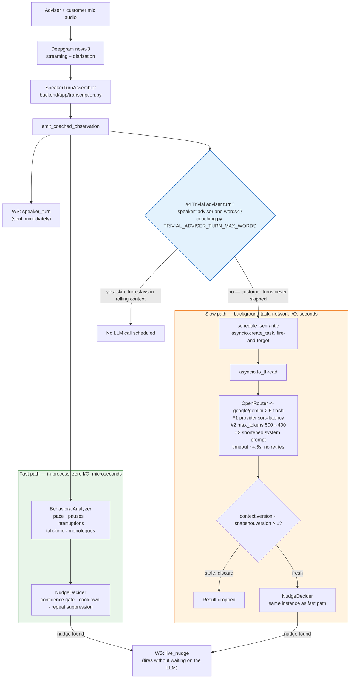

# LLM latency: what's done now vs. what's deferred

This documents the follow-up to `docs/architecture.md`'s fast/slow coaching split: four
low-risk latency changes made to the live semantic-analysis path (branch
`llm-latency-improvements`), plus two heavier options evaluated and deliberately deferred.

## Architecture: where each change sits



Both paths write into the same `NudgeDecider` instance and the same WebSocket `send`
callable, so cooldown/repeat-suppression apply uniformly regardless of which path
detected the pattern.

## Implemented now (branch `llm-latency-improvements`)

| # | Change | File | What it does |
|---|--------|------|---------------|
| 1 | Provider latency routing | `backend/app/openrouter.py` | `OPENROUTER_STRUCTURED_PROVIDER` now adds `"sort": "latency"` alongside the existing `"require_parameters": True`, so OpenRouter picks the fastest provider among those that support strict structured output, instead of an unranked one. |
| 2 | Right-sized `max_tokens` | `backend/app/semantic_analysis.py` | `max_tokens` 500 → 400, sized to the schema's realistic shape (≤300-char summary + up to 4 events) rather than the rare pathological case of 4 maxed-out events — the model's own "return every independently supported event" instruction makes that case uncommon in practice. |
| 3 | Shortened system prompt | `backend/app/semantic_analysis.py` (`INSTRUCTIONS`) | Trimmed wording (~15% shorter) while preserving every rule: role authority, per-type confidence rubric, the emotional-cue/premature-solving pair, schema enforcement, no customer quotations. Re-sent and re-processed on every live call, so every token removed is pure latency. |
| 4 | Skip trivial adviser turns | `backend/app/coaching.py` (`TRIVIAL_ADVISER_TURN_MAX_WORDS`, `CoachingSession.observe`/`schedule_semantic`) | A ≤2-word **adviser** turn ("okay", "mm-hmm", "right") cannot be a question cluster, advice/solution, or a bypassed emotional cue, so the LLM call for it is skipped entirely. **Customer turns are never skipped at any length** — a short disclosure ("I'm scared.") is exactly what this feature exists to catch. The turn still lands in rolling context, so it's visible on the next real semantic call regardless. |

All four are covered by tests (`backend/tests/test_semantic_analysis.py`,
`backend/tests/test_coaching.py`: `test_trivial_advisor_backchannel_skips_semantic_scheduling`,
`test_short_customer_turn_still_schedules_semantic`,
`test_non_trivial_advisor_turn_still_schedules_semantic`).

## Deferred for evaluation: #5 and #6

Both are real latency levers but change model behavior or infrastructure shape, so they
need a deliberate evaluation pass rather than a same-session edit.

### #5 — Lighter/alternate model for the live path

Swap `google/gemini-2.5-flash` for a lighter OpenRouter model on the **live** semantic
call only, keeping the current model for the post-meeting report (`post_meeting.py`),
which has no latency constraint.

- **Upside:** likely the single biggest latency win available, since model inference
  time dominates the ~4s budget.
- **Cost:** a quality/accuracy tradeoff against the confidence rubrics in
  `docs/architecture.md` ("Semantic Confidence") — a lighter model may under- or
  over-detect `MISSED_EMOTIONAL_CUE` / `PREMATURE_PROBLEM_SOLVING`, which is exactly the
  judgment this product depends on.
- **How to evaluate:** run the existing `test_semantic_analysis.py` fixtures (or a small
  held-out transcript set) through candidate models and compare event precision/recall
  against the current model's output before swapping live traffic.

### #6 — Pre-warm the OpenRouter connection at session start

`transcription.py:171` creates a fresh `OpenAI` client (and therefore a fresh
TCP/TLS connection) per WebSocket session. The *first* semantic call in a meeting pays
that handshake cost on top of model latency.

- **Upside:** removes a one-time cost from the first live nudge of every meeting —
  meaningful for a demo, since first impressions matter.
- **Cost:** needs a genuinely inert warm-up call (can't reuse the real schema/endpoint
  without risking a stray "event" from empty context) and a place to fire it — at
  WebSocket accept, before Deepgram is even connected — without delaying that path.
- **How to evaluate:** time the first vs. subsequent semantic call latencies as-is to
  confirm the handshake cost is actually significant before adding the extra
  request/complexity.

## Verification

```bash
cd backend
.venv/Scripts/python.exe -m compileall app tests
.venv/Scripts/python.exe -m unittest discover -s tests
```

All tests pass except one pre-existing, unrelated failure on `main`
(`test_transcription.ReflectionTranscriptAssemblerTests.test_collects_only_final_single_speaker_text`,
a Deepgram mock punctuation/capitalization mismatch) — confirmed present before this
branch's changes and out of scope here.
